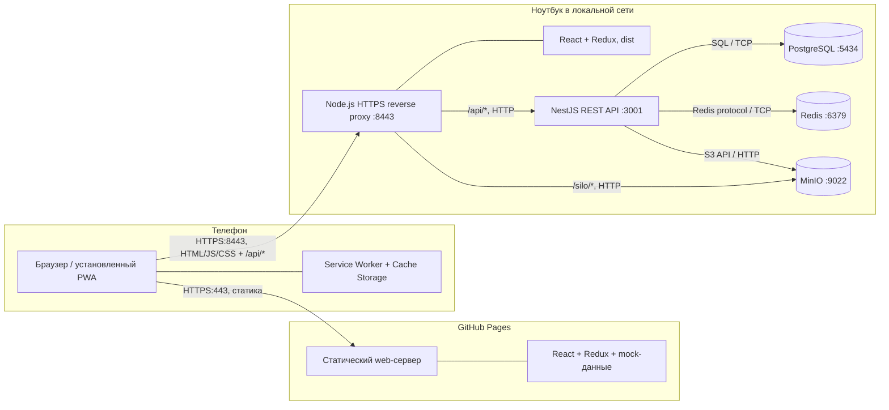

# Лабораторная работа №7 — адаптивность, PWA и HTTPS

## Запуск

Публичная сборка использует только шесть локальных mock-материалов. Она собирается командой `npm run build:pages` и публикуется workflow `.github/workflows/pages.yml` из ветки `lab6`. Адрес: `https://rayana06.github.io/Teploizolyatsiya-frontend/`. В настройках репозитория Pages следует выбрать источник **GitHub Actions**. Маршруты в этой сборке имеют вид `/#/catalog` и `/#/materials/1`, поэтому обновление страницы работает на статическом хостинге.

Для показа с реальным бэкендом:

1. Запустить контейнеры и NestJS в соседнем репозитории `insulation-backend-lab4`: `docker compose up -d`, `npm run build`, `npm start`. В `.env` задать `COOKIE_SECURE=true`.
2. В этом репозитории выполнить `npm run build`, затем `node scripts/create-local-cert.mjs <IP-ноутбука>` и `npm run serve:https`.
3. Телефон и ноутбук подключить к одной сети. Установить `certs/ca.crt` на телефон как доверенный корневой сертификат. Открыть `https://<IP-ноутбука>:8443/` и войти в приложение. Сертификат содержит этот IP в Subject Alternative Name; при смене адреса его нужно создать заново. Файлы `certs/` исключены из Git.

HTTPS-сервер Node.js обслуживает `dist`, пересылает `/api/*` и `/insulation-materials-assets/*` на NestJS (`127.0.0.1:3001`), `/silo/*` — на MinIO (`127.0.0.1:9022`). Браузер телефона обращается только к одному HTTPS origin, поэтому cookie сессии и запросы API остаются на нём.

## Адаптивность

В `src/styles.css` сетка каталога задана явно: **1 колонка до 639 px**, **2 колонки от 640 px**, **3 колонки от 1024 px**. Карточка на телефоне имеет высоту **300 px**, медиа — **158 px**; от 640 px карточка — **270 px**, медиа — **145 px**. Контейнер приложения допускает ширину до **1200 px**. На широком экране подробности показывают медиа и текст в двух колонках. На телефоне навигация учитывает `safe-area-inset-bottom`.

## Порядок 17 скриншотов

| № | Что показать |
|---|---|
| 1–2 | Открыть адрес Pages на телефоне, показать каталог и команду «Добавить на главный экран»; затем иконку установленного PWA. |
| 3–6 | Открыть PWA, на странице «Плитка» выставить цену и нажать «Подобрать»; открыть «Подробнее» и вернуться. Значение слайдера и число найденных карточек сохраняются в Redux. |
| 7 | В адаптивном режиме браузера показать ширину 390, 768 и 1200 px: соответственно 1, 2 и 3 колонки. |
| 8–12 | Открыть `https://<IP>:8443/` на телефоне, войти; показать ленту, плитку и подробности с меткой `web-service`, затем сетевой запрос `/api/insulation-materials`. |
| 13–14 | Показать `certs/openssl.cnf` с IP в SAN, доверенный `ca.crt` на телефоне и HTTPS в адресной строке. Секретные ключи на скриншот не выводить. |
| 15–17 | Показать `src/styles.css`: правила `.app-shell`, `.material-card--tile` и медиазапросы 640/1024 px, включая высоты карточки и количество колонок. |

## Контрольные вопросы

- **Flux** — однонаправленный поток данных: действие → диспетчеризация → обновление состояния → перерисовка представления. Обработчик события не меняет хранилище напрямую.
- **Redux** — `store` содержит общее состояние; `action` описывает событие; `dispatch(action)` отправляет его; `reducer(state, action)` вычисляет следующее состояние. Здесь Redux Toolkit создаёт actions и reducers в `filtersSlice`, а `CatalogPage` отправляет `setDraftFilter` и `applyFilters`. Асинхронный `loadCatalog` выполняет запрос и затем обновляет `materials`.
- **Варианты приложений** — PWA выполняется браузерным движком, ставится с сайта и может работать офлайн; Tauri упаковывает веб-интерфейс в нативную оболочку с системным WebView; Electron поставляет собственный Chromium; полностью нативные приложения пишутся для платформенных SDK. Они различаются размером, доступом к API устройства и способом распространения.
- **GitHub Pages** — статический HTTPS-хостинг файлов из репозитория или GitHub Actions. Node.js, PostgreSQL и другие серверные процессы на нём не исполняются, поэтому Pages-сборка использует mock. У проекта URL содержит имя репозитория, что учтено в `base` Vite, manifest, service worker и путях медиа.

## Deployment diagram

`/api/users/authenticate` устанавливает HttpOnly-cookie `sessionId`; `/api/insulation-materials` отдаёт каталог и принимает `maxPriceRubM2`; `/api/insulation-materials/feed` и `/api/insulation-materials/:id/next` обслуживают ленту. На Pages вызовов этих API нет.
